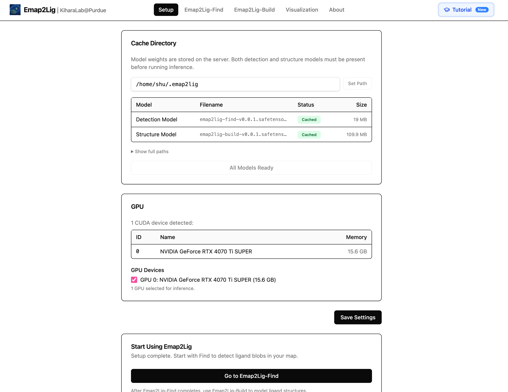
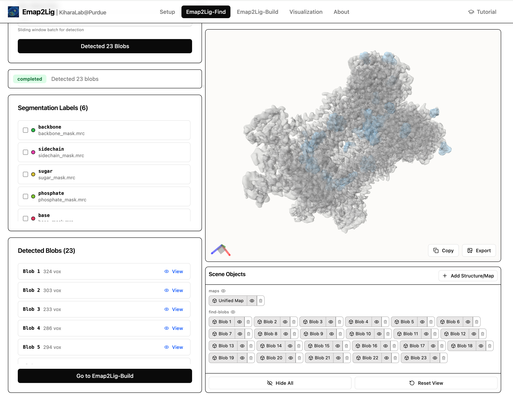
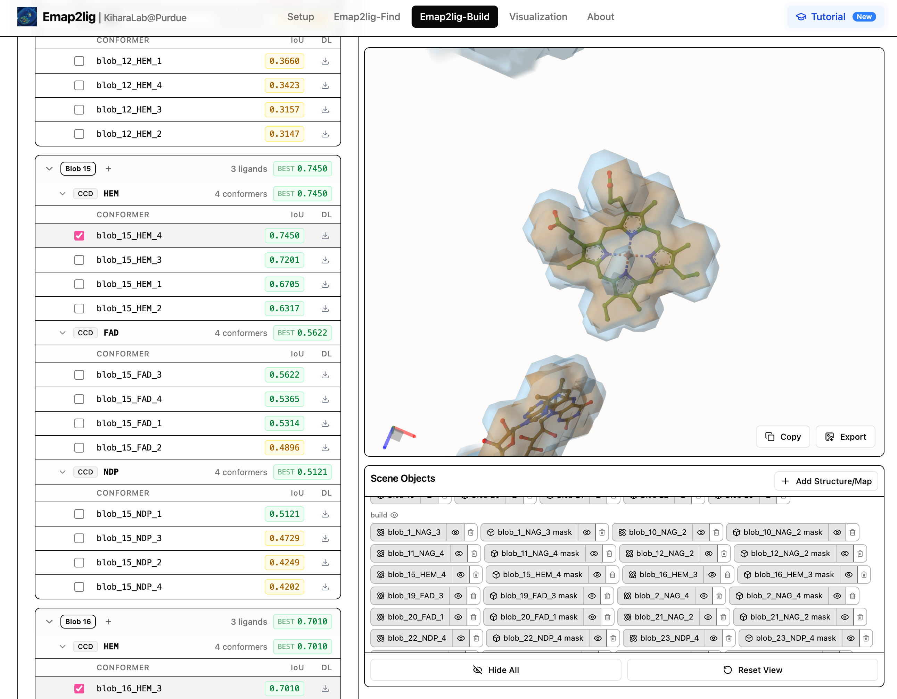

# Web GUI

Browser-based interface in `src/emap2lig/web/` with Mol* visualization. Find and
Build are separate tabs, matching the two-stage pipeline.

## Prerequisites

- Python **3.12–3.14** and [uv](https://docs.astral.sh/uv/)
- Supported local inference accelerator (same as CLI): Linux/CUDA or macOS/MPS

## Install and run

### From a clone

```bash
git clone https://github.com/kiharalab/Emap2lig.git
cd Emap2lig
uv sync --group web
uv run --group web emap2lig-gui
```

### From PyPI

```bash
pip install "emap2lig[web]"
emap2lig-gui
```

Open `http://localhost:40427` (default).

The package includes a pre-built `frontend/dist/`. **Node.js and npm are not
required** for normal use.

### Options

```bash
# Custom port
uv run --group web emap2lig-gui --port 8080

# Headless (no browser auto-open)
uv run --group web emap2lig-gui --no-browser
```

| Option | Description |
|--------|-------------|
| `--host TEXT` | Interface to bind (default: `127.0.0.1`; use `0.0.0.0` for LAN access) |
| `--port INT` | Port (default: `40427`) |
| `--no-browser` | Do not open a browser tab |

## Frontend bundle

The web UI source is not distributed. `frontend/dist/` is gitignored; wheels and
sdists include it, and a source checkout fetches it from the
[`emap2lig-webui`](https://www.npmjs.com/package/emap2lig-webui) npm package at the
version pinned in `.webui-version`:

```bash
uv run python scripts/sync_frontend.py          # sync the pinned version
uv run python scripts/sync_frontend.py 0.7.0    # sync 0.7.0, then pin it
```

The script verifies the tarball's npm integrity hash and replaces `frontend/dist/`
only if the download is valid. The release workflow runs it before `uv build`, so
commit `.webui-version` (not `dist/`) when updating the UI.

## Deployment notes

- **LAN / remote access**: `uv run --group web emap2lig-gui --host 0.0.0.0` binds all
  interfaces. Keep `127.0.0.1` (the default) when only local use is intended.
- **Transfer compression**: API and file responses are gzip-compressed when the client
  sends `Accept-Encoding: gzip` (the Mol\* bundle shrinks from ~3.0 MB to ~0.9 MB).
  Behind a reverse proxy that already compresses, the proxy sees `Content-Encoding:
  gzip` and will not double-compress.
- **Caching**: hashed assets under `/assets/` are served with
  `Cache-Control: public, max-age=31536000, immutable`; `index.html` is always
  revalidated, so upgrades take effect on the next page load.

## Workflow

- **Setup** — model cache path, download weights, accelerator selection
- **Find** — input map, detection options, inspect blobs in Mol*
- **Build** — ligands (global or per-blob), run modeling, view conformers
- **Visualization** — load an existing output directory

Input formats match the CLI: [Input formats](input-format.md).

## Interactive tutorial

Click **Tutorial** in the top-right corner of the header to start a guided
walkthrough of the full Emap2lig workflow (Setup → Find → Build →
Visualization). The tutorial loads pre-computed example results, so an
accelerator is not required to follow along.



On first visit, the button is highlighted with a **New** badge. You can restart
the tutorial anytime from the same button.

### Find and Build tabs

The walkthrough covers **Emap2lig-Find** (ligand blob detection with Mol*
visualization) and **Emap2lig-Build** (per-blob ligand assignment, structure
modeling, and ranked conformers).





## Architecture

For API routes and component layout, see
[`skills/emap2lig/references/GUI.md`](../skills/emap2lig/references/GUI.md).
